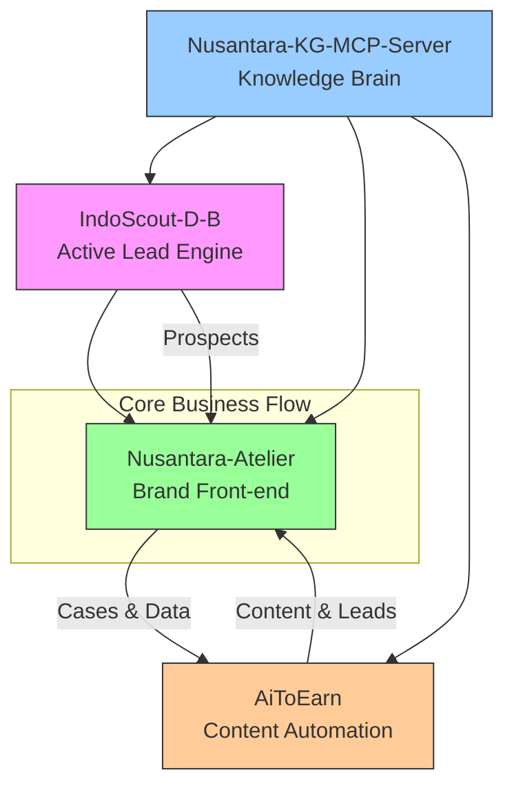

🌏 Nusantara Ecosystem


> **AI-Native Digital Toolbox for High-End Villa Design in Indonesia**  
> 专为印尼市场高端别墅全案设计打造的 OPC（一人公司）数字化工具箱
Nusantara Ecosystem enables solo entrepreneurs to achieve the precision marketing and delivery capabilities of mid-sized firms through four tightly integrated modules: Active Lead Generation + Content Funnel + Knowledge Decision + Brand Conversion.
---
🧩 Architecture Overview

Four Pillars
Module	Role	Key Capabilities
IndoScout-D-B	Active Lead Engine	Google Places scanning of premium Indonesian districts · Quality × Reach scoring · Personalized WhatsApp outreach scripts
Nusantara-KG-MCP-Server	Knowledge & Decision Brain	8 design styles × 12 space types × 53 material SKUs · Instant cost calculation · Professional talk tracks & content scripts
Nusantara-Atelier	Brand Front-end & Converter	25 real projects / 231 photos · Instant estimation tool (floor plan → quote in ~30 min) · Cloudflare Pages + D1 · ZH/EN/ID
AiToEarn	Content Marketing Automation	Batch short-video generation from real photos · Multi-platform publishing (TikTok, YouTube, IG…) · Intent detection & auto-reply · Lead sync
---
🔄 End-to-End Data Flow
Dual Acquisition — IndoScout actively scrapes high-value leads; AiToEarn attracts inbound inquiries via content.
Unified CRM — All leads flow into Atelier’s D1 database with deduplication and follow-up timeline.
Intelligent Decision — Real-time calls to KG-MCP for pricing, craftsmanship standards, and style analysis.
Trust Conversion — Clients view authentic cases and use the estimation tool on Atelier.
Flywheel — Completed projects generate new photos and data that enrich both Atelier and the knowledge graph.
---
🚀 Quick Start
Prerequisites
Cloudflare account
Node.js ≥ 20.18
Python ≥ 3.9
Docker
Clone with Submodules
```bash
git clone --recurse-submodules https://github.com/vfvincentwong2026/Nusantara-Ecosystem.git
cd Nusantara-Ecosystem
```
Deploy Individual Modules
```bash
# 1. Atelier (Cloudflare Pages)
cd submodules/Nusantara-Atelier
npm install
npm run deploy

# 2. KG-MCP Server
cd ../Nusantara-KG-MCP-Server
pip install -r requirements.txt   # or python install
python app.py

# 3. IndoScout (Cloudflare Worker)
cd ../IndoScout-D-B
npm install
npm run deploy:worker

# 4. AiToEarn
cd ../AiToEarn
docker compose up -d
```
> Update submodules later with:  
> `git submodule update --remote`
---
📊 Current Status
Module	Version	Progress	Next Milestone
Atelier	v1.0	Live site · 25 cases · Estimation tool (P1)	Online designer booking
KG-MCP	P0	Knowledge graph skeleton · 66 core nodes	Expand to 200+ nodes + vector search
IndoScout	P0	Places API integrated · Scoring model validated	WhatsApp automation + CRM dashboard
AiToEarn	v2.5	Upstream sync · Integration points ready	Luxury renovation-specific templates
---
📁 Repository Structure
```text
Nusantara-Ecosystem/
├── README.md
├── .gitmodules
├── submodules/
│   ├── Nusantara-Atelier/          # Brand front-end & conversion
│   ├── IndoScout-D-B/              # Active lead generation
│   ├── Nusantara-KG-MCP-Server/    # Knowledge decision center
│   └── AiToEarn/                   # Content marketing automation
└── docs/
    ├── architecture.md             # System architecture
    └── integration-guide.md        # Module integration guide
```
---
💡 Strategic Positioning
Traditional Design Firm	Nusantara Model
Heavy assets, large sales teams, offline exhibitions	Lightweight · AI sales assistant · AI content specialist · AI design advisor · 24/7 online showroom
Why it works in Indonesia
Deep cultural understanding of high-end Indonesian homeowners’ aesthetic preferences and decision habits
Real local material supply chain data and completed project cases (not synthetic)
Edge architecture via Cloudflare Workers for low-cost, high-availability global + local acceleration
---
🤝 Contributing
Fork the repository
Create your feature branch (`git checkout -b feature/AmazingFeature`)
Commit your changes (`git commit -m 'Add some AmazingFeature'`)
Push to the branch (`git push origin feature/AmazingFeature`)
Open a Pull Request
For submodule contributions, work inside the corresponding `submodules/` directory and submit PRs upstream.
---
📄 License
This meta-repository is released under the MIT License.  
Individual sub-projects may follow their own licenses (MIT / Apache, etc.).
---
<p align="center">
  <b>AI-Native One-Person Company · Built for the Indonesian Luxury Design Market</b><br>
  Exploring the future of solo entrepreneurship with AI.
</p>
